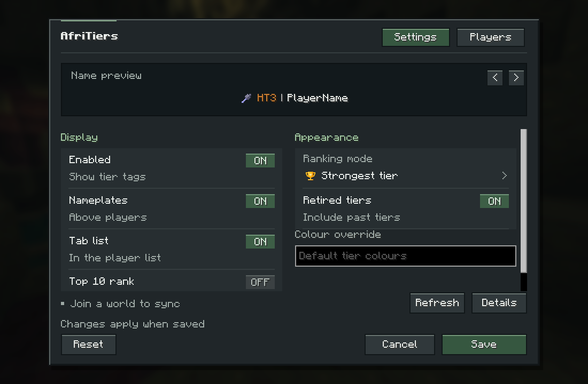
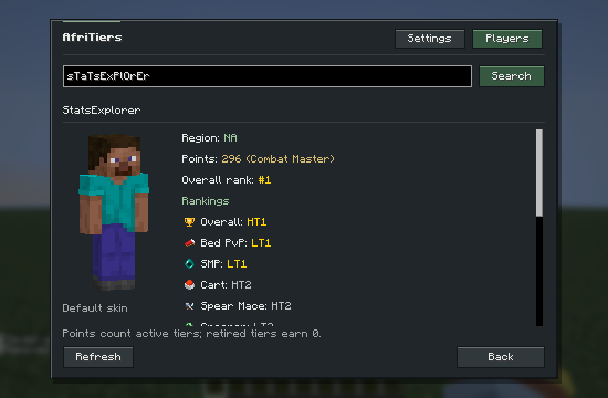

<p align="center">
  
</p>

# AfriTiers Tier Tagger

AfriTiers PvP tiers on player nametags and the Tab list, with player search and optional top-10 rankings. A client-side Fabric mod for **Minecraft Java 26.2**, powered by the [AfriTiers API](https://afritiers.co.za/api/players).

**[Download the latest release](https://github.com/CriticalVII/afritiers-tagger/releases/latest)** · [Report a bug](https://github.com/CriticalVII/afritiers-tagger/issues) · [Changelog](CHANGELOG.md)

## Features

- **Tiers where you play.** Mode icons and tier colours beside player names, with separate toggles for nametags and Tab.
- **Player search.** Look up region, points, combat title, overall position and mode tiers in the Players tab.
- **Top-10 labels.** Optional gold `#1`–`#10` rankings. Only top-ten Tab rows use aligned columns; everyone else keeps compact spacing.
- **Native Minecraft settings.** Mod Menu support, a live preview, colour overrides and a rebindable **K** shortcut.
- **Offline-account support.** Case-insensitive username matching, verified paid-account rename recovery and saved aliases for known name changes.
- **Bundled artwork.** Seventeen transparent mode icons, with no separate resource pack required. Retired tiers are included by default.

Servers and other players do not need the mod. Labels are visible on your own client.

## Installation

| Requirement | Version |
| --- | --- |
| Minecraft Java | **26.2** |
| Java | **25** |
| Fabric Loader | **0.19.5+** |
| Fabric API | **0.161.0+26.2** |
| Mod Menu, optional | **20.0.3** |

1. Install [Fabric Loader](https://fabricmc.net/use/installer/) for Minecraft 26.2.
2. Add [Fabric API for 26.2](https://modrinth.com/mod/fabric-api/versions?g=26.2) to your instance's `mods` folder.
3. Download `afritiers-tagger-1.5.0.jar` from [Releases](https://github.com/CriticalVII/afritiers-tagger/releases/latest) and place it in the same folder. Replace older copies of the mod.
4. Optionally add [Mod Menu](https://modrinth.com/mod/modmenu/versions?g=26.2), then launch Minecraft.

Install the regular mod JAR. The sources and gametest JARs are development artifacts.

## Getting started

Press **K**, use `/afritiers config`, or open **Mods → AfriTiers Tier Tagger → Configure**.

In **Settings**, choose a mode or **Strongest tier**, adjust the display options, then **Save**. Leave the colour override blank for the tier palette. Enable **Top 10 rank** to show gold ranking labels; it is off by default.

In **Players**, enter a username and press **Search** or Enter. Long profiles scroll. Returning to Settings preserves unsaved edits. Search also works before joining a world. Skin previews use an available online skin or a labelled default skin.

<table>
  <tr>
    <td></td>
    <td></td>
  </tr>
  <tr><td align="center">Settings</td><td align="center">Player search · test profile</td></tr>
</table>

Nametags use `<icon> HT3 | PlayerName`; Tab uses `<icon> HT3 PlayerName`. Top-ten labels add a gold `#<rank>` prefix. Server prefixes and nicknames retain their styling.

| Tier | Colour |
| --- | --- |
| 1 | Gold |
| 2 | Silver |
| 3 | Bronze |
| 4–5 | Gray |

[View Tab and nametag previews](docs/CONFIG_GUI.md) · [Mode icon reference](docs/MODE_ICONS.md)

## Usernames and rankings

Cracked/offline accounts match by **username**. Paid-account rename recovery uses the official Minecraft current-name lookup and verified paid profile IDs from AfriTiers. Server/offline UUIDs are never used for tier matching.

For a known name change that cannot be resolved automatically, save an alias:

```text
/afritiers alias set NewPlayer OldApiName
```

Overall positions use active-tier points, with alphabetical names breaking ties. Retired tiers and historical peaks do not earn points. Rankings reflect the available API data and refresh automatically every 5–5.5 minutes.

## Commands

| Command | Action |
| --- | --- |
| `/afritiers config` | Open settings |
| `/afritiers refresh` | Request a refresh; cooldowns apply |
| `/afritiers status [username]` | Show connection or player lookup details |
| `/afritiers alias set <current> <apiName>` | Save a username alias |
| `/afritiers alias remove <current>` | Remove an alias |
| `/afritiers alias list` | List saved aliases |

For configuration, points, rename handling and network behaviour, see the [usage guide](docs/USAGE.md).

## Building

Use JDK 25 and the included Gradle wrapper:

```sh
./gradlew build
```

On Windows, run `.\gradlew.bat build`. The installable JAR is written to `build/libs/`.

See the [development guide](docs/DEVELOPMENT.md) for test and release tasks. The release has **54 passing unit tests** and production Minecraft client checks with and without Mod Menu; see [validation](VALIDATION.md) for coverage and compatibility limits.

## Support and license

When reporting a bug, include your mod/Minecraft versions, other rendering or nametag mods, and `/afritiers status` output. Remove personal information from logs before sharing them. Rankings depend on AfriTiers availability; arbitrary server label systems and every rendering-mod combination are not guaranteed.

Source is provided under the existing **all-rights-reserved** terms in [LICENSE](LICENSE). This is not an open-source license. Minecraft, Fabric, Mod Menu and AfriTiers retain their respective names and rights.
