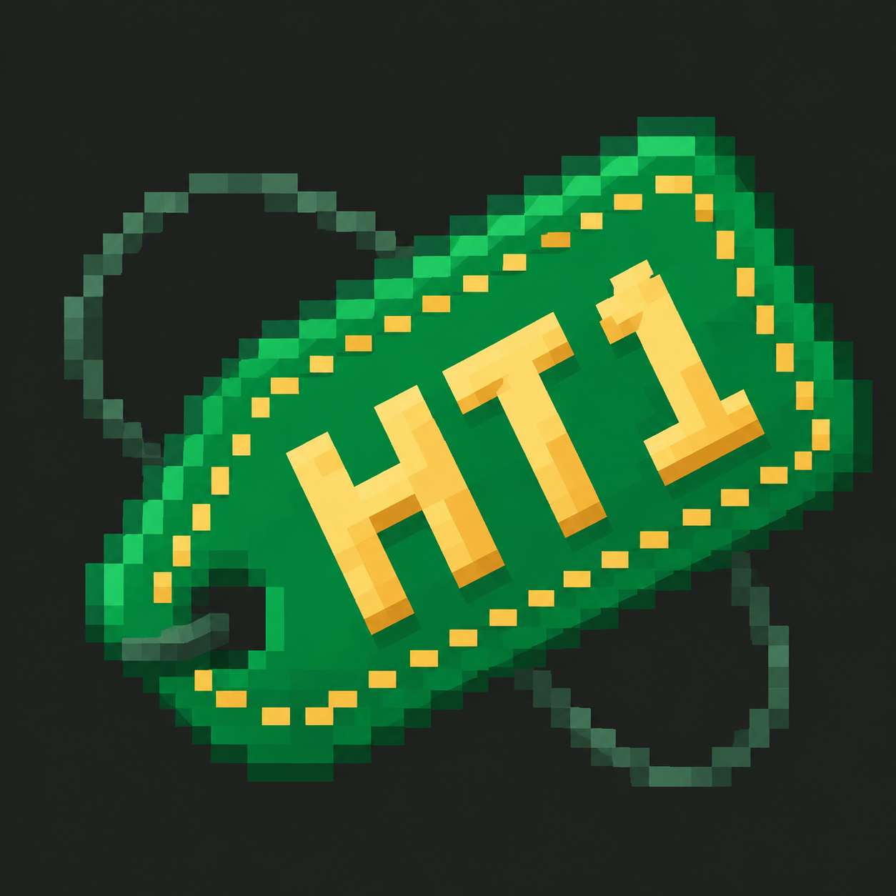

  

# AfriTiers Tier Tagger

A client-side Fabric mod for **Minecraft Java 26.2**, powered by the [AfriTiers API](https://afritiers.co.za/api/players).

- Mode icons and coloured tiers on player nametags and the Tab list.
- Transparent settings and a Profiles tab with your account, username search, region, points and rankings.
- Per-mode waitlist notifications in chat, with an optional sound and Discord join links.
- Optional gold `#1`–`#10` labels, with Tab alignment only for top-ten players.
- Automatically saved Mod Menu settings, a complete mode picker and a rebindable **K** shortcut.
- Username-based cracked/offline matching, verified paid-account rename recovery and saved aliases.

## Install

Download [afritiers-tagger-1.7.1.jar](releases/afritiers-tagger-1.7.1.jar) or get it from [GitHub Releases](https://github.com/CriticalVII/afritiers-tagger/releases/latest).

Verify downloads with the SHA-256 value in [releases/SHA256SUMS.txt](releases/SHA256SUMS.txt).

| Requirement | Version |
| --- | --- |
| Minecraft Java | 26.2 |
| Java | 25 |
| Fabric Loader | 0.19.5+ |
| Fabric API | 0.161.0+26.2 |
| Mod Menu, optional | 20.0.3 |

Install [Fabric Loader](https://fabricmc.net/use/installer/) and [Fabric API](https://modrinth.com/mod/fabric-api/versions?g=26.2), then put the mod JAR in your client instance's `mods` folder. Replace older copies. Servers and other players do not need the mod.

## Use

Press **K**, run `/afritiers config`, or open **Mods → AfriTiers Tier Tagger → Configure**. Click Ranking mode to choose a specific mode or Strongest tier. Changes save immediately; use Done or Escape to close. Invalid colour entries are not saved. Top 10 rank is off by default; retired tiers are included by default. The preview starts with Sword HT1 and a gold #1 as an example.

Profiles displays your own account with an empty search box. Search another username with Search or Enter, or run `/tiers <player>` to open their profile directly. Use My profile to return to your account and clear the search box. Tier colours are gold for tier 1, silver for tier 2, bronze for tier 3, and purple for tiers 4–5. The optional colour override applies to tags; profile stats retain tier colours. Nametags and Tab use spaces between the icon, tier and username, with no added pipe separator.

Cracked/offline accounts match by username. Paid rename recovery uses verified paid IDs from AfriTiers and the official current-name lookup. Server/offline UUIDs are never used for tier matching. Your profile uses your account skin; other profiles use an available online skin or a labelled default skin.

| Command | Action |
| --- | --- |
| `/tiers <player>` | Open Profiles and search the specified player |
| `/tiers` | Open your own profile with an empty search box |
| `/afritiers config` | Open settings |
| `/afritiers refresh` | Request a refresh |
| `/afritiers status [username]` | Show connection or player details |
| `/afritiers alias set <current> <apiName>` | Save a known name change |
| `/afritiers alias remove <current>` | Remove an alias |
| `/afritiers alias list` | List aliases |

Settings are saved in `config/afritiers_tagger.json`. Joining a server requests a fresh sync. World changes, respawns and server teleports also refresh tiers, including hub-to-Practice transfers that keep the same connection. Valid tiers remain visible while these transfer refreshes wait for the existing request cooldown. Rapid transfers share one pending refresh. Rankings also refresh automatically and depend on upstream API availability.

## Waitlist notifications

Open **Waitlists** and enable the modes you want to watch. No modes are selected by default. Choices save automatically; All and None change the entire selection. Notifications pauses alerts without clearing your choices, and Sound controls the notification chime.

The mod checks the [AfriTiers queues API](https://afritiers.co.za/api/queues) about every 30 seconds while you are in a world with watched modes, or while the Waitlists tab is open. Selected waitlists notify you in chat once per opening, including when already open at the first sync. A new API event can trigger a new alert. Available Discord channel links appear as a clickable Join action.

Alerts work independently of tier-tag visibility and are only delivered in game. Repeated polls and server reconnects do not repeat an alert for the same opening. API errors and stale responses do not trigger alerts; requests retry automatically and respect service cooldowns.

## Build

Use JDK 25 and run `./gradlew build`, or `.\gradlew.bat build` on Windows. The build writes the mod JAR to `build/libs/`.

The repository contains production source/assets, build files and the latest released JAR in `releases/`.

## License

All rights reserved. See [LICENSE](LICENSE).
