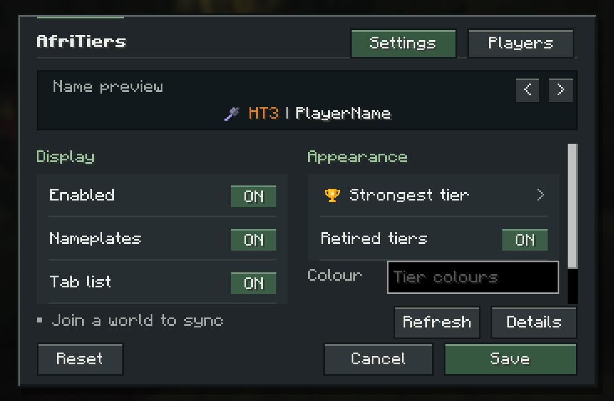
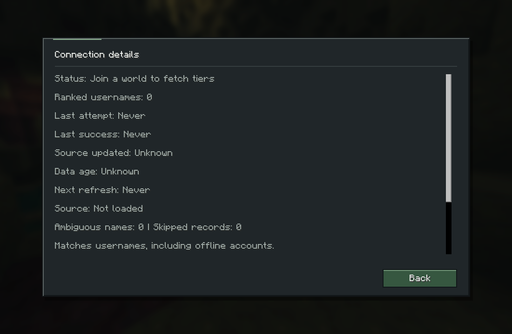
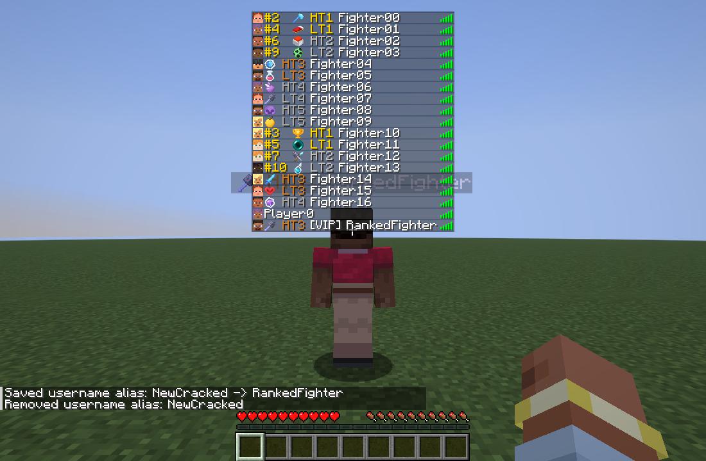

# Native configuration GUI

The 1.3.0 redesign adapts the requested gpt-taste design guidance to Minecraft's native GUI: a centered composition, inline mode icons, an interactive tier preview and a separate details view. The interface uses the existing Minecraft pixel font and renderer, square bevels and muted green accents. It has no browser, web font, React or GSAP dependency.

The panel is capped at 460×326 GUI pixels. Taller screens show two groups of descriptive controls. Short screens use 26px rows; screens narrower than 340 GUI pixels stack the groups in a native scrolling container. The nametag preview, connection summary and Save/Cancel actions remain outside that scrolling area.

All controls use native widgets, retaining click sounds, mouse and keyboard interaction, narration and focus outlines. Hover colour transitions last about 100ms and become immediate when Minecraft's Screen Effects setting is zero. There is no automatic preview cycling, camera movement or animated scrolling.

Save validates and persists the draft. Cancel/Escape discard it. Reset changes only the draft. Opening Details and returning preserves the draft. Invalid hex values highlight the colour field and disable Save while keeping the live preview usable. The preview arrows cycle all ten HT/LT ranks without changing the actual ranking selection.

Version 1.5.0 adds Settings/Players tabs in the existing header, retaining the same panel, native pixel font, bevels and colours. The Players tab searches API usernames and verified paid aliases, shows region, active points, combat title, overall rank and mode tiers, and scrolls long profiles. Returning to Settings preserves the draft. Search/Enter submits a valid username; Refresh shares repository cooldown rules. The preview uses an available online skin or a labelled native default skin.

The Display group includes Top 10 rank, off by default. Enabling it adds overall `#1`–`#10` prefixes in HT1 gold (`FFD700`) to the live preview, Tab labels and nametags, independently of the selected mode. The top ten are determined from the normalized snapshot using active points descending and alphabetical ties. Positions beyond ten are omitted from labels.

Top-ten Tab rows align automatically when Top 10 rank is enabled. Exact-width invisible space glyphs align their columns without changing icon sizes or adding a pipe. Other rows retain compact spacing; unranked rows have no added indentation. Widths are measured from the visible top-ten players with the current Minecraft font.

